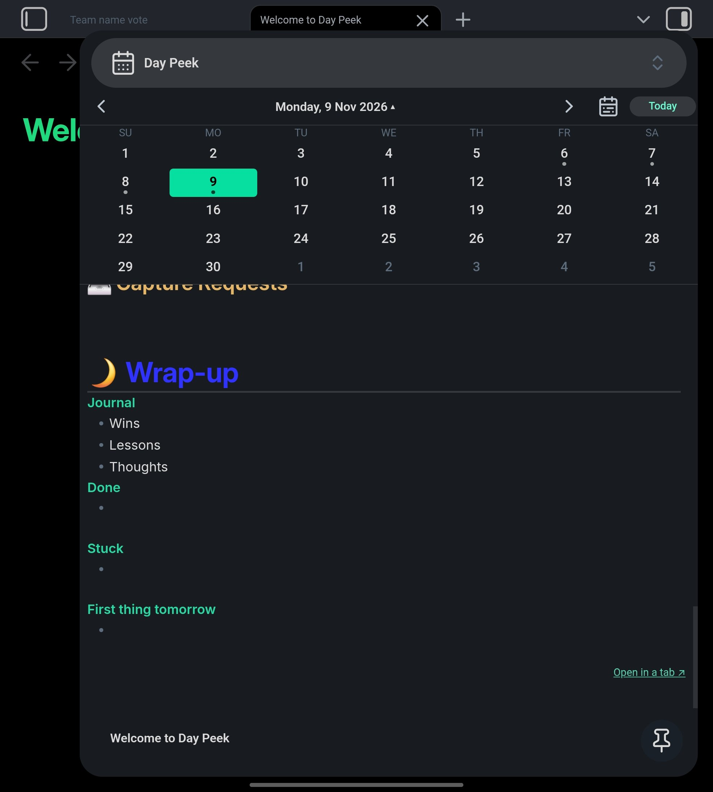
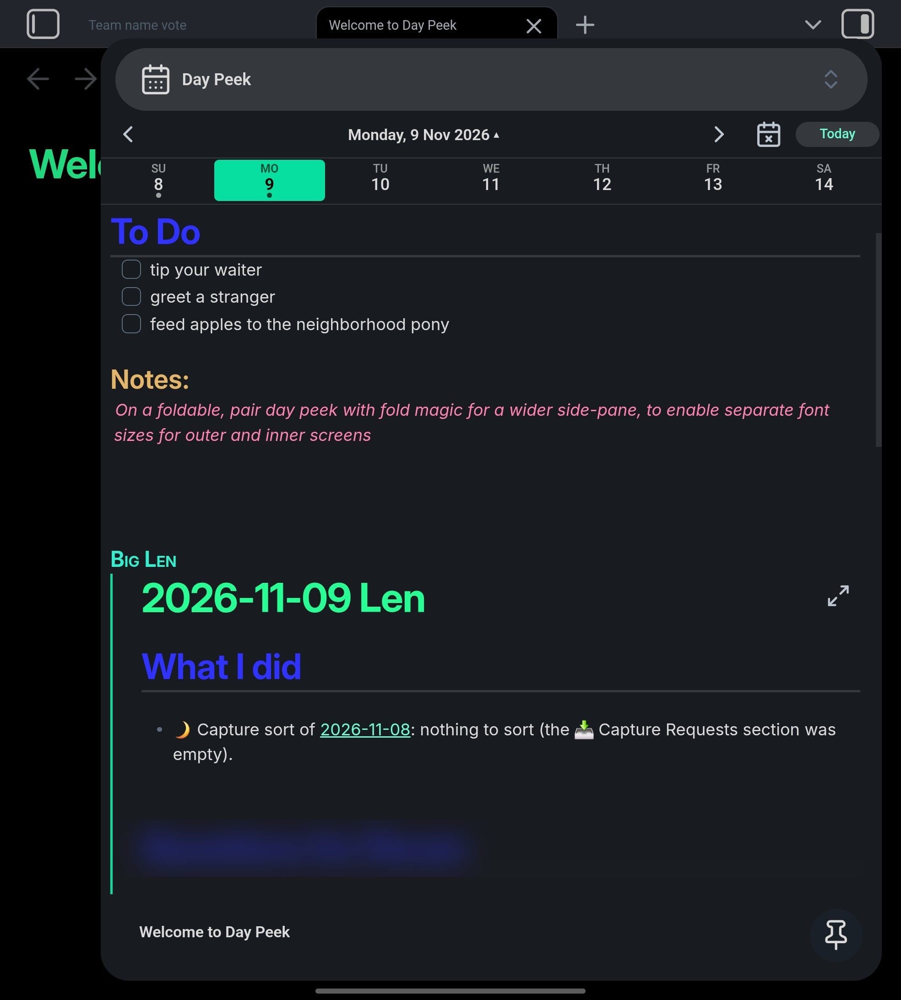
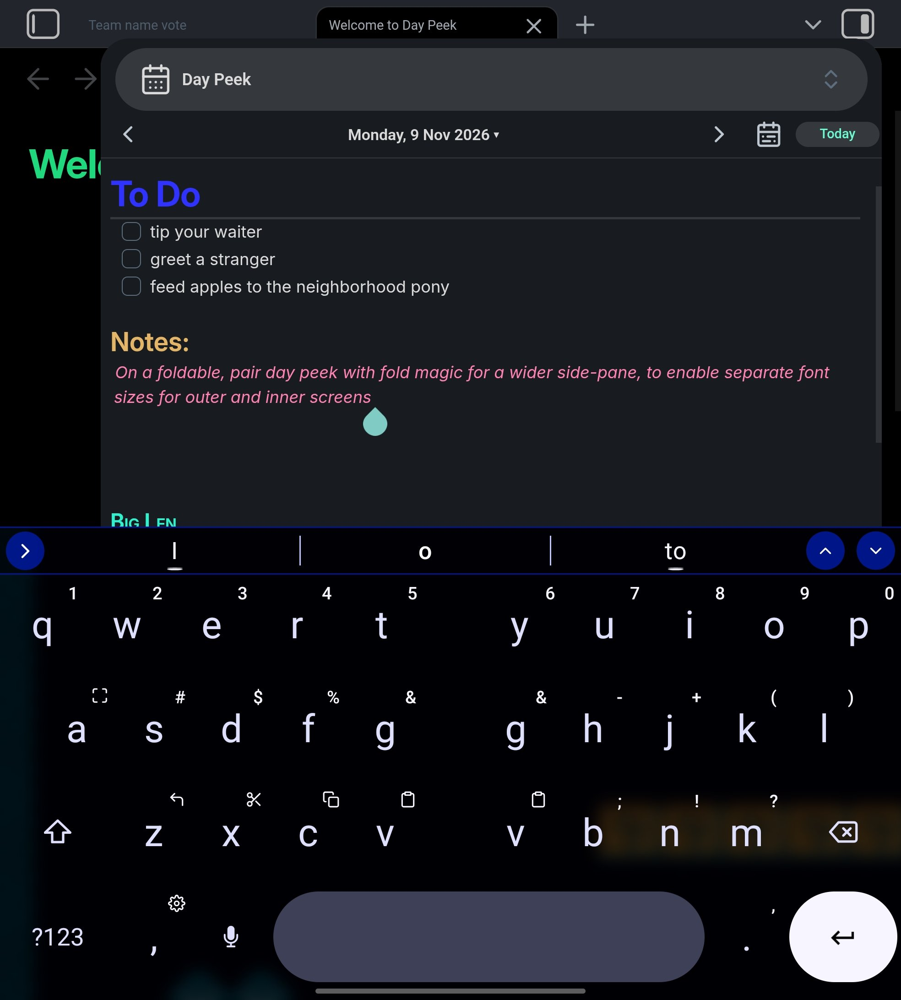
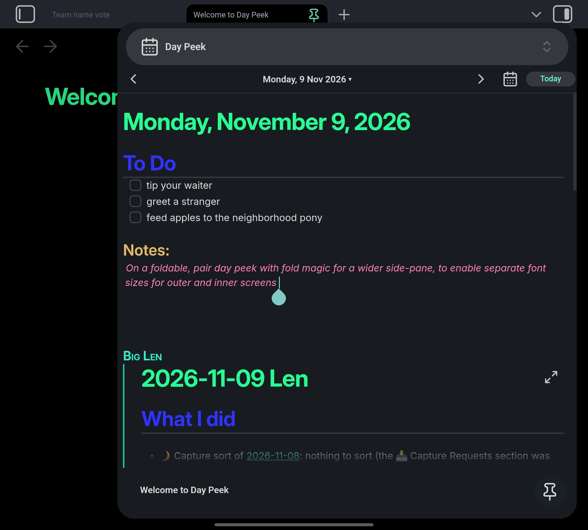
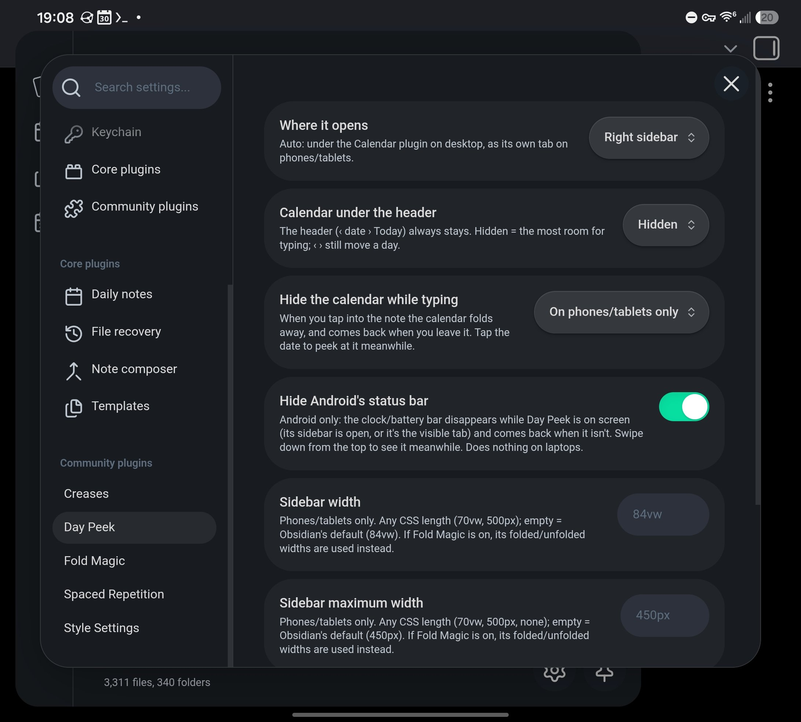

# Day Peek

An Obsidian plugin: a mini calendar with the selected day's **daily note right below it, editable in place**.

- Header: `▲▼ | Nov | '26 | ‹ 9 › | GO TO TODAY`. ▲▼ show the previous/next month, tap the month or the year for a 4 × 3 picker, ‹ › move a day, tap the day number for the whole month, Go to today jumps back
- **Folds as you scroll the note** (0.8.0): the other weeks slide away and your week stays, then its numbers slide under the weekday names, then the names slide under the header. Scroll back up and it unfolds. Or pick *Cascade*: the bottom week tucks under the one above it, then the next, and so on
- None of the header or calendar taps closes the phone keyboard
- Dots on days that have a daily note; "Create it" uses your daily-note template
- Edit the note without opening it; edits are saved immediately when you switch days or leave the app
- Follows changes from sync (Syncthing, Obsidian Sync…) live, and rolls over to the new day at midnight
- Phone-friendly: compact layout, optional "hide the calendar while typing", optional "open at startup"
- Works on desktop and mobile

Uses the core **Daily notes** plugin's settings (folder, date format, template).

## Screenshots

Day Peek in the right sidebar on a Galaxy Z Fold 7 (unfolded; these show 0.7, before the 0.8.0 header):

| Month view | Week strip | Editing with the keyboard up |
|---|---|---|
|  |  |  |

| Calendar hidden (most room for the note) | Settings |
|---|---|
|  |  |

## Install

**With BRAT:** add the beta plugin `SnakeJaeger/day-peek`.

**By hand:** download `main.js`, `manifest.json` and `styles.css` from the [latest release](../../releases/latest) into `<your vault>/.obsidian/plugins/day-peek/`, then enable *Day Peek* under Settings → Community plugins.

## Settings

| Setting | Options |
|---|---|
| Where it opens | Auto (below the Calendar plugin on desktop, a tab on mobile), right sidebar, tab |
| Calendar at rest | Month, one week, hidden (how much shows with the note scrolled to the top) |
| Fold on scroll | Slide, cascade, off |
| Hide the calendar while typing | Phones/tablets only, always, never |
| Open at startup | Phones/tablets only, always, never |
| Hide Android's status bar | On / off (Android app only: hides the system clock/battery bar while Day Peek is on screen, e.g. its sidebar is open) |
| Sidebar width / maximum width | Phones/tablets: any CSS length (`70vw`, `500px`, `none`); empty = Obsidian's default. With [Fold Magic](https://github.com/SnakeJaeger/fold-magic) on, its folded/unfolded widths are used instead |

## Good to know

The editable note uses Obsidian's internal embed editor (`app.embedRegistry`), the same approach the Kanban plugin uses. It isn't a public API, so if an Obsidian update changes it, Day Peek falls back to a read-only preview with a warning instead of breaking.

No build step: `main.js` is plain JavaScript.

## Credits

Made by **Tailnet 4**.

## License

[MIT](LICENSE) © 2026 Tailnet 4
